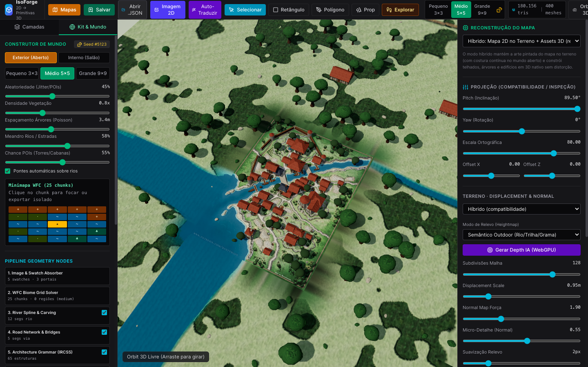
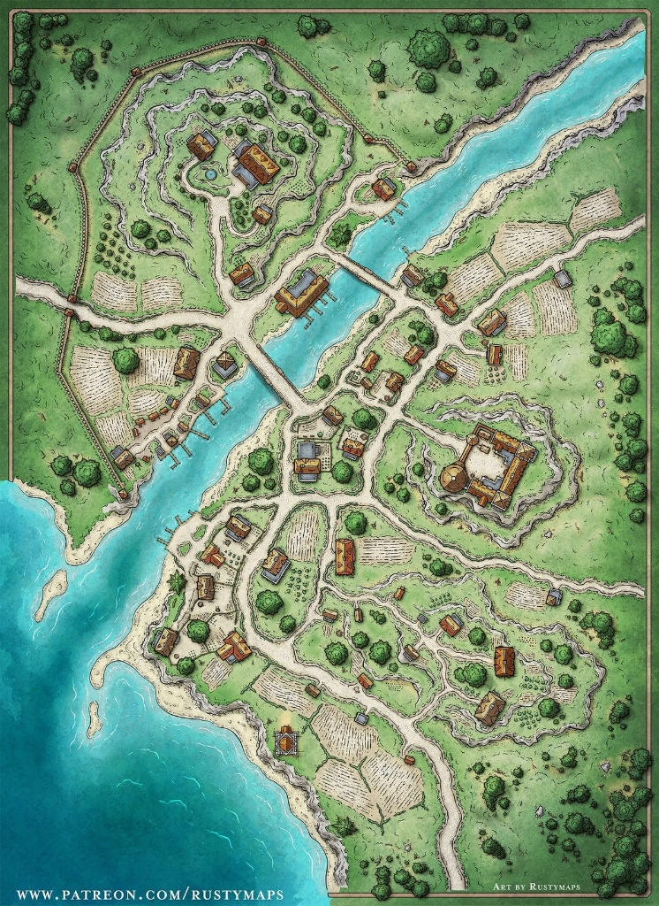
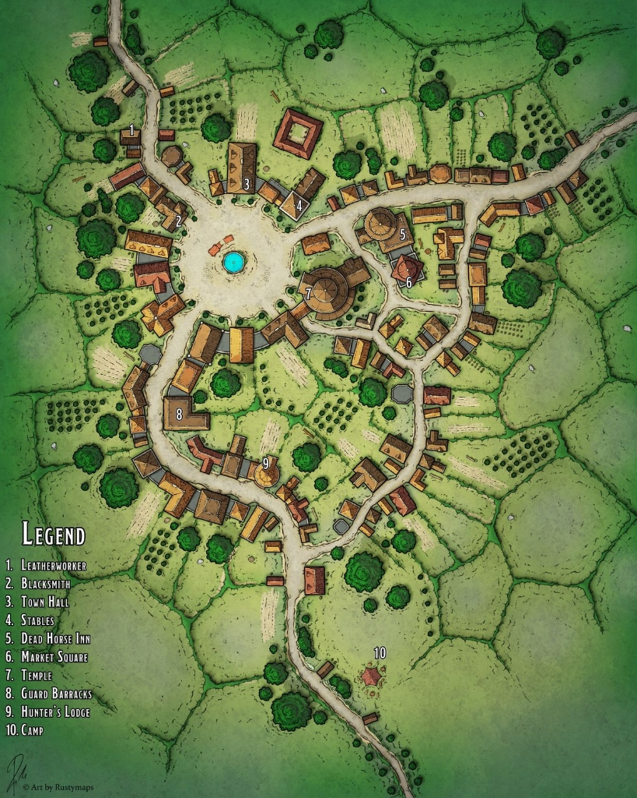
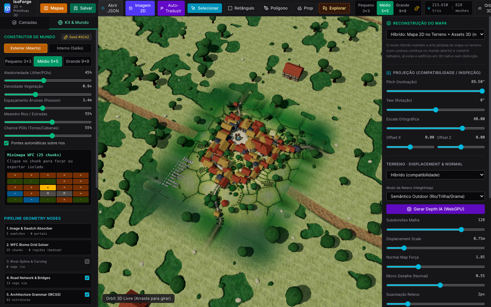
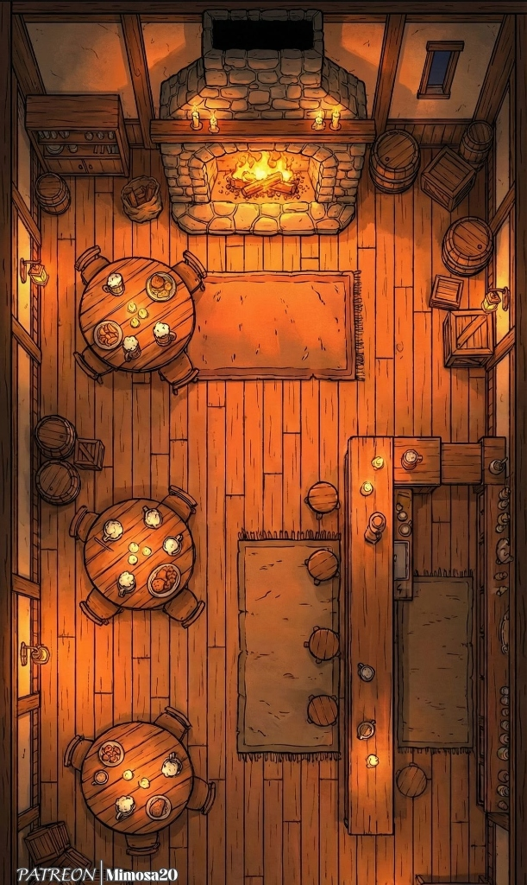
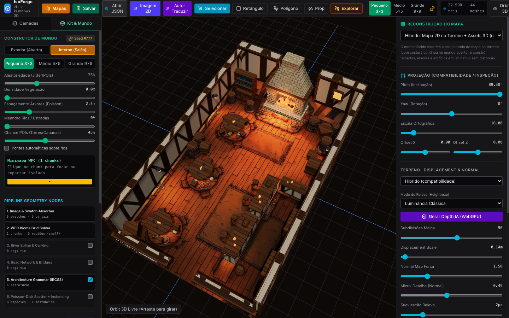
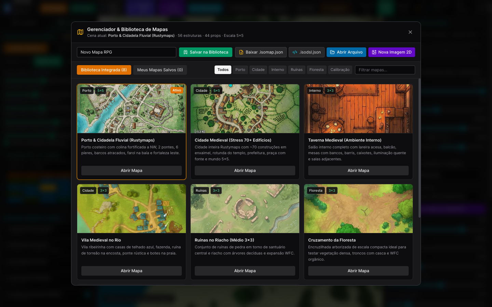

# 🗺️ Ultimate RPG Map Creator
> **De Ilustrações 2D a Mundos 3D Abertos, Vivos e Prontos para Engines**

[](https://react.dev/)
[](https://threejs.org/)
[](https://www.typescriptlang.org/)
[](https://vitejs.dev/)
[](https://godotengine.org/)
[](LICENSE)

Ferramenta web moderna desenvolvida em **React 18 + TypeScript + Three.js** que reconstrói ilustrações 2D (**Top-Down** e **Isométricas** desenhadas à mão) como cenários 3D ultraleves prontos para **WebGL, Godot 4, Unity e Unreal**, sem malhas infladas ou distorções, empregando **leitura semântica de regiões**, **primitivas paramétricas**, **materiais procedurais**, **Displacement & Normal Maps Sobel 3×3**, **Absorção Multi-Imagem (`IsoWorldKit`)** e **Wave Function Collapse (WFC)** em escalas **Pequeno (1×1)**, **Médio (3×3)** e **Grande (5×5 e 9×9)**.



---

## 🌟 Vitrine Visual: 2D Original vs Reconstrução 3D

### 1. Porto & Cidadela Fluvial (Rustymaps)
*Rio diagonal em calha orgânica, pontes de pedra, píeres com barcos e fortaleza em encosta rochosa em um mundo WFC 5×5 contínuo.*

| Imagem 2D Original | Reconstrução 3D Procedural |
| :---: | :---: |
|  |  |

---

### 2. Cidade Medieval de Grande Porte (Stress Test 80+ Edifícios)
*Cidade completa com 70+ residências em enxaimel, praça circular com fonte, templo em rotunda e estradas que se ramificam naturalmente pelo bioma adjacente.*

| Imagem 2D Original | Reconstrução 3D Procedural |
| :---: | :---: |
|  |  |

---

### 3. Taverna Medieval (Ambiente Interno / Dungeon Crawler)
*Salão interno com lareira acesa e iluminação dinâmica suave, vigamentos em madeira escura, mesas com canecos e pratos, balcão de serviço e sistema de corte de teto.*

| Imagem 2D Original | Reconstrução 3D Procedural |
| :---: | :---: |
|  |  |

---

## 🗂️ Gerenciador & Biblioteca de Mapas

Abra o modal de gerenciamento a qualquer momento para navegar pelo catálogo ou salvar seu progresso:



- **8 Mapas Pré-definidos Integrados:** Portos, cidades medievais, ruínas com santuário central, tavernas fechadas e florestas densas.
- **Meus Mapas Salvos (Persistência Local):** Salve no `localStorage` do navegador com nome customizado e contagem de props.
- **Importação & Exportação:** Baixe ou carregue projetos em `.isomap.json` e arquivos de especificação leves `.isodsl.json`.
- **Drag & Drop:** Arraste qualquer nova ilustração 2D diretamente na janela para reconstruir do zero.

---

## ⚡ Principais Recursos Técnicos

- **Reconstrução Semântica Procedural:** Rios, caminhos, clareiras, vegetação e construções viram geometria nativa, preservando a nitidez sem deformar a arte sobre malhas 3D esticadas.
- **Vegetação com Troncos Orgânicos:** Corrige a limitação dos mapas aéreos gerando troncos cilíndricos com shader de casca rústica antes da copa esférica/cônica.
- **Eliminação de Costuras (Edge Stitching Contínuo):** 48 tiras de blend de borda (`edgeStrips`) combinadas com normalização de altura garantem que o mundo WFC conecte com o mapa central sem linhas de recorte ou "caixas".
- **Expansão WFC Multi-Escala:** Expansor baseado em Wave Function Collapse com resolução orgânica de biomas, estradas interligadas e pontes automáticas sobre canais fluviais.
- **Modo Exploração com Corte de Teto (Cross-Section Clipping):** Navegue com um personagem cilíndrico em escala humana e veja o interior dos edifícios se revelar no estilo *The Sims* ou *Baldur's Gate*.
- **Depth IA WebGPU Opcional:** Suporte a geração de mapas de profundidade via *Depth Anything V2* direto no navegador via ONNX/WebGPU sob demanda.

---

## 🎮 Exportação para Game Engines (Godot 4 & Unity)

O exportador integrado gera arquivos `.glb` otimizados e com hierarquia semântica:

```
WorldRoot
├── Terrain_Chunk_0_0 (Mesh + Texture + Displacement Baked)
│   └── Terrain_Chunk_0_0_Collider (CollisionMesh)
├── Water_Plane (com shader de água)
├── Architecture_Group
│   ├── House_01_Walls (com BoxCollider / MeshCollider)
│   ├── House_01_Roof
│   └── House_01_Door (Porta móvel com pivô correto)
└── Vegetation_Instanced (MultiMeshInstance3D no Godot / InstancedMesh)
```

- **No Godot 4:** Basta arrastar o `.glb` para `res://scenes/`. Os nós com sufixo `-colonly` e `MultiMesh` são reconhecidos nativamente com performance máxima.
- **Na Unity:** Importe para a pasta `Assets/Maps/` e marque **Generate Colliders** no inspetor. A malha do terreno já possui as elevações assadas nos vértices.

---

## 🚀 Como Executar

### Pré-requisitos
- Node.js 18+ (recomendado Node 20+)
- npm 9+

```bash
# 1. Clonar o repositório
git clone https://github.com/F4bs04/ultimate-rpg-map-creator.git
cd ultimate-rpg-map-creator

# 2. Instalar dependências
npm install

# 3. Iniciar servidor de desenvolvimento
npm run dev
# Acesse no navegador: http://localhost:5173/

# 4. Executar suíte de testes (Vitest)
npm test

# 5. Build de produção
npm run build
```

---

## 🤖 Skill para IAs Locais (`.agents/skills/isoforge-map-translator/`)

Qualquer agente ou modelo de visão local (Ollama `qwen2.5vl`, `llama3.2-vision`, Antigravity, LM Studio) pode usar a skill incluída:

```bash
# Medir imagem e calcular tamanho exato do terreno
node .agents/skills/isoforge-map-translator/scripts/uv-helper.mjs --image public/maps/ruinas-rio.jpg --ortho 32

# Calcular footprint rotacionado para muros em ângulo
node .agents/skills/isoforge-map-translator/scripts/uv-helper.mjs --width 18 --depth 32 --wall 0.06,0.075,0.25,0.04,0.58

# Gerar IsoDSL via Ollama local com loop automático de validação e reparo
node .agents/skills/isoforge-map-translator/scripts/translate-image-local.mjs public/maps/ruinas-rio.jpg --model qwen2.5vl --scale medium --out meu-mapa.isodsl.json

# Validar e compilar triângulos/chunks de qualquer arquivo .isodsl.json
node .agents/skills/isoforge-map-translator/scripts/validate-and-build.mjs meu-mapa.isodsl.json
```

---

## 📄 Licença

Este projeto é disponibilizado sob a licença [MIT](LICENSE).
Sinta-se livre para usar, estudar, expandir e incorporar nos seus próprios jogos e campanhas de RPG!
